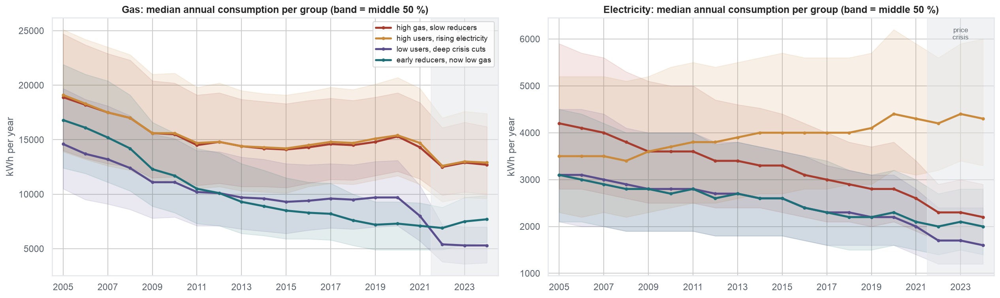
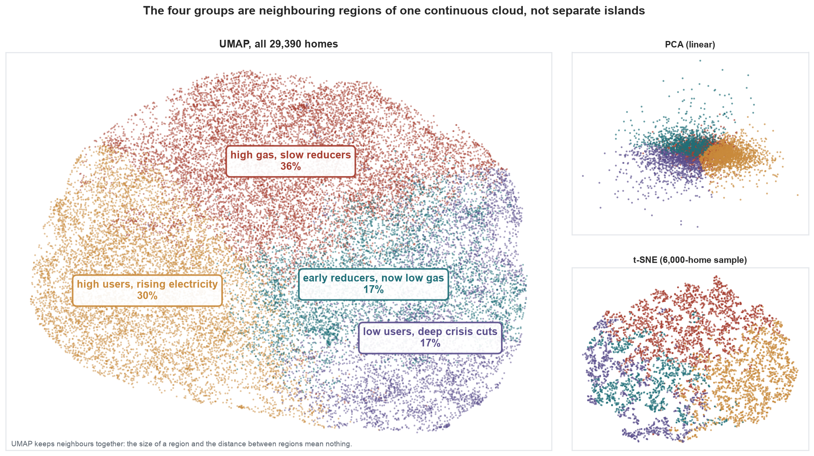
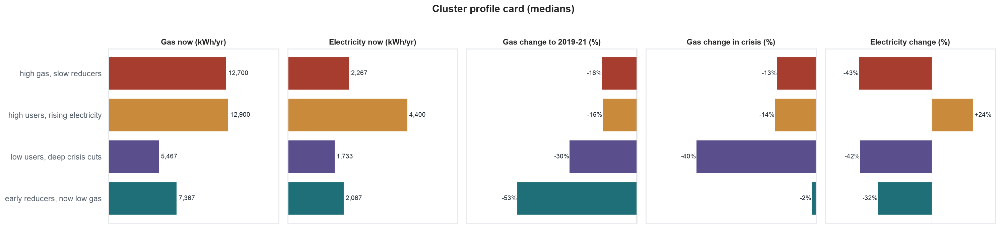

# Household Energy Trajectories: unsupervised learning on 29,000 homes

**Team:** Group 4 – Luis, Fawad, Hetashree ,Daria.
**Course:** AI Methods I – Day 3: Unsupervised learning (IAAC MaAI 2026/27)
**Dataset on Hugging Face:** https://huggingface.co/datasets/iaac-maai/day3-group4-household-energy-trajectories
**Model on Hugging Face:** https://huggingface.co/iaac-maai/day3-group4-household-energy-typologies

## Use case
A local authority or an energy-efficiency programme has to decide **which households to contact first**. We group 29,390 gas-heated homes in England and Wales by **how much energy they use today and how their use changed over 20 years** (2005–2024). Each group points to an action: insulate, check for fuel poverty, or no action needed. On Day 2 we predicted next year's gas use. This time there is no target: we look for structure.

## Dataset
| | |
|---|---|
| **Name** | National Energy Efficiency Data-Framework (NEED), anonymised 50k sample, as cleaned in our Day 1/2 assignment |
| **Source** | UK Department for Energy Security and Net Zero, [NEED](https://www.gov.uk/government/collections/national-energy-efficiency-data-need-framework) · our cleaned file: [Group4-day2-assignment](https://github.com/iaac-maai/Group4-day2-assignment/blob/main/data/anon2026_50k_cleaned.csv) |
| **Rows used** | 29,390 (one row = one gas-heated home with valid readings in all three time windows) |
| **Licence** | Open Government Licence v3.0 (original) · our clustered dataset: OGL v3.0 with attribution |

We kept the Day 1/2 dataset, so this repository needs only **one notebook**.

## Repository structure
```
├── data/        # anon2026_50k_cleaned.csv is downloaded here by the notebook (not committed)
├── dataset/     # dataset card (README.md) + its figures; the CSV lives on Hugging Face
├── figures/     # all exported plots (01_… to 12_…)
├── models/      # model card (README.md); model.joblib lives on Hugging Face
├── notebook/    # unsupervised_learning.ipynb
├── .gitignore
├── LICENSE
├── README.md
└── requirements.txt
```

## How to run
```bash
python -m venv .venv
source .venv/bin/activate        # Windows: .venv\Scripts\activate
pip install -r requirements.txt
```
Open `notebook/unsupervised_learning.ipynb`, select the `.venv` kernel and run all cells (about 1 minute). The notebook downloads the data if `data/` is empty. It writes `figures/`, `models/model.joblib` and `dataset/need_household_energy_trajectories.csv`.

## Approach
The notebook follows **three steps**:

1. **Dimensionality reduction:** PCA (explained variance and loadings), then **t-SNE** and **UMAP** to draw the homes in 2D.
2. **Clustering:** **K-Means** (k = 2…10, scored with elbow, silhouette, Calinski–Harabasz and Davies–Bouldin), **hierarchical Ward** clustering (dendrogram) and **DBSCAN** (k-distance plot). We compare them with the ARI and test stability over seeds and 80 % subsamples.
3. **Application:** we profile each cluster, cross-tabulate it with building characteristics we did *not* cluster on, and give it a name and a suggested action.

- **Unit of analysis:** one home. Up to 40 yearly meter readings are summarised into 3 time windows: 2005–08, 2019–21 and 2022–24, using only readings flagged valid (`V`).
- **Features we cluster on (5):** gas and electricity use now (log10 kWh); gas change 2005–08 → 2019–21; gas change during the 2022 price crisis; electricity change since 2005 (all changes as log2 ratios).
- **Features kept aside for interpretation:** dwelling type, age, floor area, council-tax band, EPC, deprivation (IMD), region, cavity-wall, loft and PV flags.
- **Preprocessing:** log transforms (consumption is skewed, changes are ratios), then `StandardScaler` inside the pipeline.
- **Final model:** `StandardScaler → KMeans(k=4)`. The data is one continuous cloud (DBSCAN finds a single dense cluster), so we need an algorithm that *cuts* it into balanced groups that are stable and can `.predict()` new homes. K-Means does all three. DBSCAN is kept as an outlier flag.

## Results
| Cluster | Name | Size | Defining features | Suggested action |
|---|---|---|---|---|
| 3 | **high gas, slow reducers** | 10,724 (36 %) | 12,700 kWh gas; only −16 % since 2005, −13 % in the crisis; fewest EPC A–C (17 %), most without an EPC (47 %); larger homes | **Retrofit priority** |
| 0 | **high users, rising electricity** | 8,787 (30 %) | 12,900 kWh gas and the most electricity (4,400 kWh, **+24 %** since 2005); large, less deprived homes, more of them in London and the South East | Large-home retrofit + electricity advice / PV |
| 1 | **low users, deep crisis cuts** | 4,966 (17 %) | Lowest use (5,470 kWh gas); gas **−40 % in 2022** after a stable decade; small homes, the most deprived | **Fuel-poverty check** (possible under-heating) |
| 2 | **early reducers, now low gas** | 4,913 (17 %) | Gas halved before 2021 (−53 %), flat in the crisis; most insulation (CWI 24 %) and EPC A–C (33 %) | Low priority, monitor |

**Quality of the grouping:** silhouette 0.18 (weak separation: household behaviour is a continuum). Stability is high: ARI 0.98 across seeds and ≥ 0.94 across 80 % subsamples. K-Means and Ward agree only partly (ARI 0.27).





More figures: [PCA](figures/02_pca_explained_variance.png) · [choice of k](figures/04_choice_of_k.png) · [dendrogram](figures/05_dendrogram.png) · [DBSCAN](figures/06_dbscan_k_distance.png) · [algorithms compared](figures/07_algorithms_compared.png) · [stability](figures/08_stability.png) · [cross-tabs](figures/10_crosstabs_building_characteristics.png)

## Limitations
- The groups cut a **continuum** (silhouette ≈ 0.18). Use them to target at group level, not to judge single households.
- Only gas-heated homes with valid readings in all three windows (29,390 of 40,445). Newer homes and electrically heated homes are excluded.
- Annual data cannot tell efficiency gains apart from occupancy changes. "Deep crisis cuts = under-heating" is a hypothesis that needs survey data.
- Other choices of windows, features or k would draw other borders. Ward clustering cuts the same data differently.
- Valid only for England and Wales, 2005–2024. Not a forecast of future consumption.

## AI usage disclosure
| | |
|---|---|
| **Tools** | Claude Code (agent): Coding assistant for the analysis and project structure|
| **Why** | To speed up the code and the plots, and to get a structured first draft of the interpretation |
| **Where** | Feature engineering, clustering code, figures, first drafts of the cluster names, README, model card and dataset card |
| **How** |The agent prototyped several feature sets and chose k from the metrics table, then proposed names from the profiles and cross-tabs. **To do by the team:** check every number in the cards against the notebook output, and confirm or change the cluster names and their justification |

**Lessons learned:** *(to fill in by the team)*

## License
Code released under the [MIT License](LICENSE). The data is subject to its own licence (Open Government Licence v3.0, see above).
