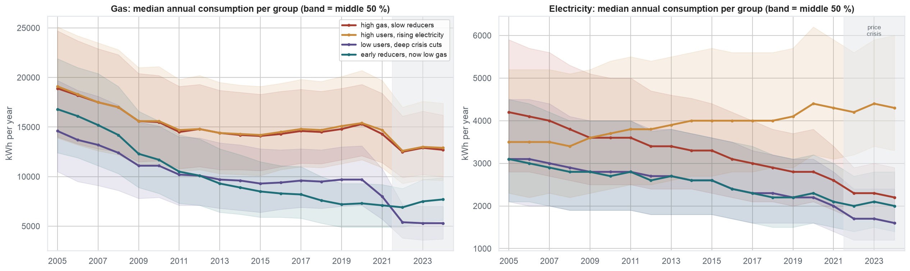
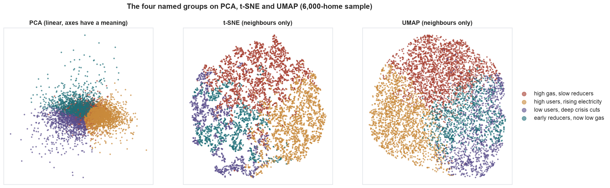
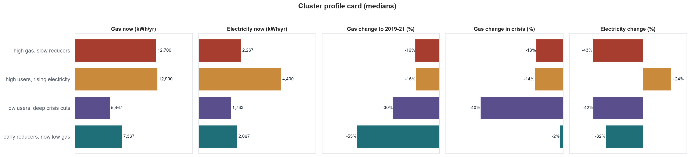

# Household energy trajectories (NEED, England & Wales, 2005–2024), clustered

29,390 gas-heated homes, each with 20 years of valid annual gas and electricity readings, engineered trajectory features, and an **energy-behaviour group** found with K-Means. Each row also carries 2D coordinates on PCA, UMAP and, for a 6,000-home sample, t-SNE maps. Made by Group 4 for AI Methods I (IAAC MaAI 2026/27).

- **Model:** [iaac-maai/day3-group4-household-energy-typologies](https://huggingface.co/iaac-maai/day3-group4-household-energy-typologies)
- **Code:** https://github.com/iaac-maai/<repo-name>

## Source and licence
Derived from the **National Energy Efficiency Data-Framework (NEED) anonymised dataset**, UK Department for Energy Security and Net Zero, via our Day 1 cleaned 50k sample. Contains public sector information licensed under the [Open Government Licence v3.0](https://www.nationalarchives.gov.uk/doc/open-government-licence/version/3/). The data is anonymised and has no addresses or personal identifiers. `home_id` is a new row number.

## What we changed
1. Kept only gas-heated homes (`MAIN_HEAT_FUEL == 1`).
2. Set readings not flagged valid (`V`) to missing.
3. Averaged three windows (2005–08, 2019–21, 2022–24; at least 2 valid readings each) and kept the homes with all five windows.
4. Added log features, the K-Means cluster and its name, the Ward label and DBSCAN outlier flag (sample only), and the map coordinates.

## The groups
| cluster | cluster_name | Homes | Description |
|---|---|---|---|
| 3 | high gas, slow reducers | 10,724 | ~12,700 kWh gas, only −16 % since 2005; fewest EPC A–C. Retrofit priority |
| 0 | high users, rising electricity | 8,787 | ~12,900 kWh gas and the most electricity, +24 % since 2005; large homes |
| 1 | low users, deep crisis cuts | 4,966 | Lowest use; gas −40 % in 2022; most deprived. Possible under-heating |
| 2 | early reducers, now low gas | 4,913 | Gas halved before 2021, stable since; most insulated |





## Columns
| Column(s) | Description |
|---|---|
| `home_id` | Row number (no link to the original IDs) |
| `prop_type`, `prop_age_band`, `floor_area_band`, `council_tax_band` | Dwelling type; age band (1 = oldest); floor-area band (1 = smallest); council-tax band |
| `imd_band`, `region`, `region_name`, `epc` | Deprivation quintile (1 = most deprived, England or Wales index); ONS region code and name; EPC band |
| `cwi_flag`, `li_flag`, `pv_flag` | Cavity-wall insulation, loft insulation, solar PV (1 = installed) |
| `gas_2005` … `gas_2024`, `elec_2005` … `elec_2024` | Valid annual consumption, kWh (empty = missing or not valid) |
| `gas_early_kwh`, `gas_pre_kwh`, `gas_recent_kwh`, `elec_early_kwh`, `elec_recent_kwh` | Window averages (2005–08, 2019–21, 2022–24) |
| `log_gas_recent`, `log_elec_recent`, `gas_change_long`, `gas_change_crisis`, `elec_change_long` | The 5 clustering features (log10 levels, log2 change ratios) |
| `cluster`, `cluster_name` | Final K-Means group (0–3) and its name |
| `cluster_ward` | Ward hierarchical label (k = 4), only for the 6,000-home sample |
| `dbscan_outlier` | DBSCAN noise flag (eps = 1.0), only for the sample |
| `pca_x`, `pca_y`, `umap_x`, `umap_y` | 2D coordinates, all homes |
| `tsne_x`, `tsne_y` | t-SNE coordinates, only for the sample |

## Limitations
The groups cut a continuum (silhouette ≈ 0.18) and should be used at group level. Annual readings cannot tell efficiency apart from changes in occupancy. Newer and electrically heated homes are excluded. Readings are rounded to 100 kWh.

## How to load
```python
import pandas as pd
df = pd.read_csv("hf://datasets/iaac-maai/day3-group4-household-energy-trajectories/need_household_energy_trajectories.csv")
df.plot.scatter("umap_x", "umap_y", c="cluster", cmap="tab10", s=2)
```
